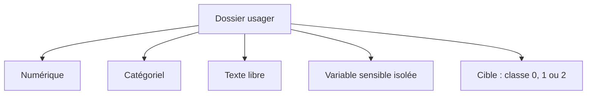
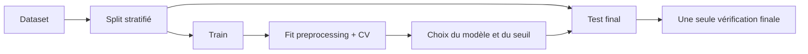
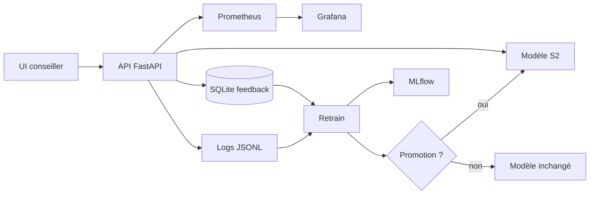
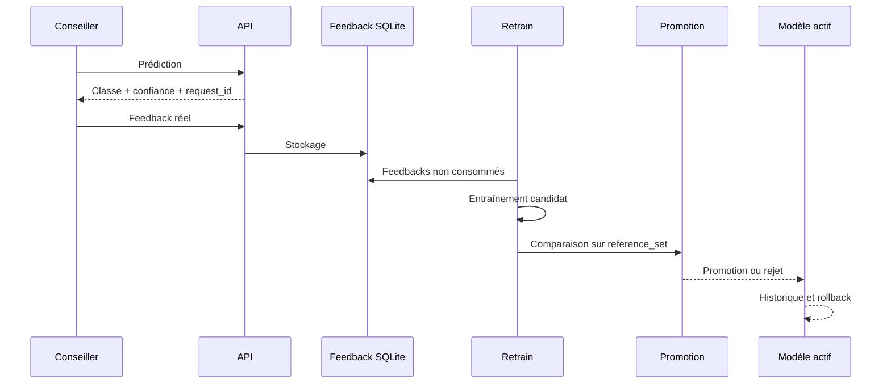

# Présentation de certification — Classification multimodale

## Consigne de narration

### Histoire à raconter

La présentation raconte une seule transformation, plutôt qu'une liste de composants : au départ, un conseiller doit repérer les situations qui risquent de passer sous le radar ; l'analyse révèle que le meilleur score brut dépend d'une variable sensible ; le projet choisit alors une solution moins performante mais plus défendable, ajoute une règle d'escalade, puis construit les moyens de la surveiller et de la corriger.

La tension centrale est : **comment gagner en détection sans transformer une prédiction en décision injuste ou incontrôlable ?**

La progression suit cinq actes :

1. **Le risque humain** : slides 1 à 2, pourquoi le problème compte et quelle erreur est la plus grave.
2. **Les preuves et les compromis** : slides 3 à 9, ce que montrent les données, les scénarios et le coût éthique mesuré.
3. **La réponse métier** : slides 10 à 12, comment le modèle et sa règle d'escalade réduisent le risque sans fuite sur le test.
4. **Le passage au service** : slides 13 à 19, comment l'API, l'UI et l'infrastructure rendent la solution utilisable, traçable et réversible.
5. **La responsabilité** : slides 20 à 22, limites, état final et décision défendue devant le jury.

Le fil conducteur est le suivant :

> Comment transformer un modèle de classification sur des données sensibles en un outil d'aide à l'orientation, mesurable, explicable, surveillé et réversible ?

La présentation suit le déroulement réel du projet : besoin métier, données, choix de modélisation, arbitrage éthique, réduction des erreurs critiques, puis industrialisation complète.

**Règle orale :** terminer chaque slide par la question qui motive la suivante. Les phrases de transition ci-dessous servent de passerelles ; elles ne sont pas destinées à être affichées sur les slides.

---

## Slide 1 — Introduction : sujet, problème et histoire

**Durée indicative : 1 min**

### Texte à afficher

**Sujet**

Prédire le délai de retour à l'emploi à partir de données tabulaires et d'une synthèse d'entretien.

**Problème**

Comment repérer les situations à risque de longue durée sans laisser passer les cas les plus graves ni automatiser une décision injuste ?

**Histoire racontée**

Comprendre les données -> comparer les scénarios -> assumer le compromis éthique -> réduire les erreurs critiques -> construire un service surveillé et réversible.

### Visuel

Un chemin en cinq étapes, du besoin métier au système en production :


### Message oral

« Je vais vous raconter comment je suis passé d'un besoin métier — mieux repérer le risque de chômage de longue durée — à un outil d'aide à l'orientation. Le point difficile n'était pas seulement d'obtenir un bon score : il fallait aussi décider quelles données utiliser, comment traiter les erreurs graves, puis rendre le système contrôlable en conditions réelles. »

**Transition :** « Pour comprendre les choix qui suivent, commençons par préciser ce que le modèle doit prédire et quelle erreur il ne doit surtout pas commettre. »

---

## Slide 2 — Le problème métier

**Durée indicative : 1 min 30**

### Texte à afficher

Le système doit prédire une classe de retour à l'emploi :

| Classe | Interprétation métier |
|---|---|
| 0 | Retour rapide : moins de 6 mois |
| 1 | Retour intermédiaire : 6 à 12 mois |
| 2 | Risque de longue durée : plus de 12 mois |

L'erreur la plus grave est :

> Une situation réellement en classe 2 prédite en classe 0.

### Visuel

Une matrice de confusion simplifiée avec la cellule `2 -> 0` en rouge.

### Message oral

« Toutes les erreurs ne se valent pas. Une personne qui aurait besoin d'un accompagnement renforcé peut ne pas être identifiée. Cette asymétrie du risque va guider toutes mes décisions de modélisation et d'industrialisation. »

**Transition :** « Cette priorité métier pose une question immédiate : quelles informations avons-nous le droit et la capacité d'utiliser ? »

---

## Slide 3 — Les données disponibles

**Durée indicative : 1 min 30**

### Texte à afficher

**2 500 dossiers — 10 colonnes**

- Variables numériques : âge, ancienneté
- Variables catégorielles : diplôme, métier visé, allocation, géographie
- Texte libre : synthèse de l'entretien
- Cible : classe de retour à l'emploi
- Variable sensible directe : `nationalite_hors_ue`

### Visuel

Schéma de composition d'un dossier :



### Message oral

« Le caractère multimodal est important : je ne travaille pas uniquement sur des colonnes, mais aussi sur une synthèse d'entretien. En parallèle, la nationalité est identifiée dès le départ comme une variable sensible à encadrer. »

**Transition :** « Avant d'entraîner quoi que ce soit, j'ai donc commencé par vérifier ce que ces données racontent réellement, et où elles peuvent nous induire en erreur. »

---

## Slide 4 — Ce que l'EDA m'a appris

**Durée indicative : 1 min 30**

### Texte à afficher

Principaux constats :

- Classe 2 minoritaire : environ 18,1 % des dossiers
- Valeurs manquantes modérées sur plusieurs variables
- Écarts de distribution liés à la nationalité
- Proxys possibles : âge, allocation, géographie, texte libre
- Texte peu diversifié : risque de sur-apprentissage sur certaines formulations

### Visuel

Insérer une sortie du notebook montrant :

- distribution de la cible ;
- valeurs manquantes ;
- analyse des variables sensibles.

### Message oral

« L'EDA ne sert pas seulement à faire des graphiques. Elle m'a permis d'identifier le déséquilibre, les risques de biais et les limites de qualité du texte avant de choisir le pipeline. »

**Transition :** « Ces constats n'ont de valeur que si l'évaluation reste fiable ; il faut donc éviter que le test influence les choix. »

---

## Slide 5 — Le protocole pour éviter la fuite de données

**Durée indicative : 1 min 30**

### Texte à afficher

1. Séparation train / test stratifiée
2. Ajustement des transformations uniquement sur le train
3. Transformation du test sans réapprentissage
4. Validation croisée sur le train
5. Test conservé pour l'évaluation finale

Prétraitements :

- Imputation numérique et catégorielle
- Encodage ordinal du diplôme
- One-hot encoding des catégories nominales
- TF-IDF pour le texte
- Extraction du département depuis le code INSEE

### Visuel



### Message oral

« Cette séparation est essentielle. Le test ne doit pas influencer le choix du modèle ni le choix du seuil d'escalade. C'est pour cette raison que j'ai ensuite ajouté une calibration hors échantillon. »

**Transition :** « Le protocole est fixé ; je peux maintenant comparer plusieurs façons de représenter le dossier, y compris sans la variable sensible. »

---

## Slide 6 — Quatre scénarios pour séparer performance et conformité

**Durée indicative : 1 min 30**

### Texte à afficher

| Scénario | Question posée |
|---|---|
| S1 multimodal complet | Quel est le meilleur score avec toutes les variables ? |
| S2 sans variable sensible | Quel est le coût de l'exclusion de la nationalité ? |
| S3 texte seul | Quelle est la valeur du texte d'entretien ? |
| S4 tabulaire seul | Quelle est la valeur des données structurées ? |

### Message oral

« S1 sert de référence expérimentale. S2 est le scénario de production potentiel. Cette comparaison permet de rendre visible le prix de la conformité au lieu de le masquer. »

**Transition :** « Pour lire cette comparaison correctement, il faut choisir des métriques qui reflètent à la fois l'équilibre global et le risque métier. »

---

## Slide 7 — Métriques retenues

**Durée indicative : 1 min**

### Texte à afficher

- **F1 macro** : équilibre entre les trois classes
- **Recall classe 2** : capacité à identifier les situations longues
- **Erreurs `2 -> 0`** : risque métier prioritaire
- **ROC-AUC macro OVR** : qualité du classement probabiliste
- **Latence p95** : compatibilité avec un entretien
- **Coût CPU** : comparaison opérationnelle des scénarios

### Message oral

« Je ne retiens pas une seule métrique. Le F1 macro donne une vision globale, mais le recall de la classe 2 et les erreurs `2 -> 0` donnent la lecture métier. »

**Transition :** « Avec cette grille, les résultats montrent précisément ce que l'on gagne et ce que l'on sacrifie selon le scénario. »

---

## Slide 8 — Résultats comparatifs

**Durée indicative : 2 min**

### Texte à afficher

| Scénario | Modèle | F1 macro CV | Recall classe 2 CV | Erreurs `2 -> 0` sur test | Latence p95 |
|---|---|---:|---:|---:|---:|
| S1 multimodal complet | XGBoost | 0,708 | 0,572 | 9 | 0,067 ms |
| S2 sans variable sensible | XGBoost optimisé | 0,681 | 0,558 | 10 | 0,075 ms |
| S3 texte seul | LogisticRegression | 0,635 | 0,661 | 12 | 0,020 ms |
| S4 tabulaire seul | RandomForest | 0,672 | 0,589 | 8 | 0,270 ms |

### Visuel

Insérer le tableau exécuté de la section 5.4 ou une version graphique des F1 macro.

### Message oral

« S1 est meilleur en score global, mais il utilise directement une variable sensible. S2 perd un peu en performance, tout en conservant le caractère multimodal et un temps d'inférence comparable. »

**Transition :** « Je ne veux pas laisser cet arbitrage dans des adjectifs : voici le coût mesuré de l'exclusion. »

---

## Slide 9 — Le prix de la décision éthique

**Durée indicative : 2 min**

### Texte à afficher

Retirer `nationalite_hors_ue` entraîne :

- F1 macro : `0,708 -> 0,681`, soit `-0,027`
- Recall classe 2 : `0,572 -> 0,558`, soit `-0,014`

> « J'accepte une baisse de 0,027 de F1 pour ne pas utiliser un critère de discrimination. »

### Message oral

« C'est le principal arbitrage du projet. Je ne prétends pas que l'exclusion est gratuite. Je mesure son coût, je l'assume et je vérifie qu'il reste compatible avec l'usage métier. »

**Transition :** « Mais retirer la variable sensible ne suffit pas à réduire l'erreur la plus grave ; il faut aussi adapter la décision du modèle. »

---

## Slide 10 — Modifier le meilleur modèle pour réduire le risque

**Durée indicative : 2 min**

### Texte à afficher

Le modèle retenu reste **S2 + XGBoost**.

La modification porte sur la règle de décision :

- prédiction automatique si le modèle est suffisamment confiant ;
- statut `a_revoir` si la confiance est trop faible ;
- escalade également si le modèle prédit 0 avec un risque latent de classe 2.

Politique combinée :

```text
escalade si confiance < seuil
ou si prédiction = 0 et P(classe 2) >= 0,20
```

### Message oral

« Je ne change pas uniquement d'algorithme. Je modifie le comportement du meilleur modèle en ajoutant un garde-fou qui tient compte du coût asymétrique des erreurs. »

**Transition :** « Ce garde-fou dépend d'un seuil. Pour le défendre, je dois le choisir sans réutiliser le test qui servira à l'évaluer. »

---

## Slide 11 — Choisir le seuil sans tricher avec le test

**Durée indicative : 2 min**

### Texte à afficher

Le seuil est calibré avec des probabilités **out-of-fold** sur le train :

1. 5 folds stratifiés
2. Une prédiction pour chaque observation, produite par un modèle qui ne l'a pas vue
3. Test d'une grille de seuils
4. Choix de la politique
5. Vérification unique sur le test final

Décision :

- seuil combiné : `0,70`
- budget d'escalade visé : environ `40 %`
- couverture OOF : environ `72,5 %`
- vérification test : `8/10` erreurs critiques captées, soit `80 %`

### Message oral

« Le test n'a pas servi à choisir le seuil. Il a seulement servi à vérifier une fois la décision prise. C'est une différence importante pour défendre la validité de l'évaluation. »

**Transition :** « Une fois ce protocole respecté, je peux formuler clairement le choix de production et ses conditions d'usage. »

---

## Slide 12 — Décision finale de modélisation

**Durée indicative : 1 min**

### Texte à afficher

**Modèle de production : S2 + XGBoost**

Pourquoi ?

- respecte l'exclusion de la variable sensible directe ;
- conserve les données tabulaires et le texte ;
- obtient un compromis acceptable entre performance et conformité ;
- fonctionne avec une politique d'escalade humaine ;
- reste suffisamment rapide pour l'usage API.

S1 reste une référence expérimentale pour mesurer l'impact de l'exclusion.

**Transition :** « Ce choix devient concret lorsqu'un conseiller envoie un dossier : il faut un contrat de service robuste, pas seulement un pipeline dans un notebook. »

---

## Slide 13 — Transformer le modèle en API

**Durée indicative : 1 min 30**

### Texte à afficher

L'API FastAPI expose notamment :

- `GET /health`
- `POST /predict`
- `POST /retrain`
- `GET /metrics`
- `GET /models/history`
- `POST /rollback`
- `POST /feedback`

Chaque prédiction retourne :

- classe prédite ;
- confiance ;
- statut `ok` ou `a_revoir` ;
- version du modèle ;
- `request_id` pour la traçabilité.

### Visuel

Capture recommandée :

- `reports/figures/api-swagger.png`

### Message oral

« Le modèle devient un composant de système. L'API valide les entrées, charge le bon artefact, journalise l'appel et permet de rattacher un feedback à une prédiction. »

**Transition :** « Pour que cette réponse soit utilisable pendant un entretien, il faut aussi la présenter clairement à la personne qui accompagne l'usager. »

---

## Slide 14 — Une UI pour le conseiller

**Durée indicative : 1 min**

### Texte à afficher

L'interface permet de :

- saisir les informations d'un usager ;
- lancer une prédiction ;
- visualiser la classe et la confiance ;
- voir le statut de revue humaine ;
- consulter l'historique ;
- déclencher un retrain ou un rollback contrôlé.

### Visuels

- `reports/figures/ui-homepage.png`
- `reports/figures/ui-prediction-result.png`

### Message oral

« L'interface rend le résultat compréhensible : elle ne montre pas seulement une classe, elle montre aussi le niveau de confiance et indique quand une intervention humaine est nécessaire. »

**Transition :** « L'écran n'est que la partie visible ; derrière lui, plusieurs composants doivent rester cohérents et observables. »

---

## Slide 15 — Architecture de la solution

**Durée indicative : 2 min**

### Visuel principal



### Texte à afficher

- API conteneurisée
- Artefact modèle versionné
- Logs d'inférence et de retrain
- Feedback terrain stocké séparément
- Monitoring Prometheus / Grafana
- Tracking MLflow

### Message oral

« L'architecture répond au besoin de ne pas laisser le modèle isolé. Chaque prédiction peut être observée, corrigée par un feedback, réévaluée et reliée à une version de modèle. »

**Transition :** « Pour savoir si cette chaîne reste saine dans le temps, je dois distinguer la santé du service du comportement du modèle. »

---

## Slide 16 — Monitoring : observer le système et le modèle

**Durée indicative : 1 min 30**

### Texte à afficher

Prometheus et Grafana suivent notamment :

- volume de prédictions ;
- classes prédites ;
- distribution des confiances ;
- taux d'abstention ;
- latence API ;
- erreurs HTTP ;
- événements de retrain.

### Visuels

- `reports/figures/prometheus-targets.png`
- `reports/figures/grafana-dashboard-1.png`
- `reports/figures/grafana-dashboard-2.png`

### Message oral

« Le monitoring ne se limite pas à savoir si le serveur est allumé. Il permet aussi de voir comment le modèle se comporte et si les dossiers deviennent plus souvent incertains. »

**Transition :** « Observer ne suffit pas : il faut aussi pouvoir retrouver exactement quel modèle et quels paramètres ont produit un résultat. »

---

## Slide 17 — MLflow et traçabilité des modèles

**Durée indicative : 1 min**

### Texte à afficher

MLflow conserve :

- paramètres d'entraînement ;
- métriques ;
- features utilisées ;
- artefacts du modèle ;
- identifiant du run ;
- décision de promotion ou de rejet.

### Visuel

Capture à prendre dans MLflow :

- liste des runs ;
- comparaison candidat / production ;
- métriques F1 et recall classe 2 ;
- artefact du modèle promu.

### Message oral

« L'objectif est de pouvoir répondre à la question : quel modèle a produit cette prédiction, avec quelles données, quels paramètres et quelles performances ? »

**Transition :** « Cette traçabilité devient utile lorsqu'un feedback arrive et qu'il faut décider si un nouveau candidat mérite réellement de remplacer la production. »

---

## Slide 18 — Feedback, retrain, promotion et rollback

**Durée indicative : 2 min**

### Visuel principal



### Texte à afficher

- Les feedbacks sont rattachés à un `request_id`.
- Le candidat est comparé à la production sur un `reference_set` figé.
- Le recall classe 2 est prioritaire.
- Un candidat rejeté ne remplace pas le modèle actif.
- Une promotion archive l'ancien modèle.
- Un rollback restaure une version précédente.

### Message oral

« La boucle d'amélioration est contrôlée. Le système peut apprendre du terrain, mais il ne remplace pas automatiquement la production sans règle de décision, historique et possibilité de retour arrière. »

**Transition :** « Pour que cette boucle soit répétable et pas seulement démontrée sur ma machine, il faut automatiser les vérifications et les livraisons. »

---

## Slide 19 — Docker et CI/CD

**Durée indicative : 1 min 30**

### Texte à afficher

Docker Compose orchestre :

- API ;
- MLflow ;
- Prometheus ;
- Grafana ;
- retrain planifié.

GitHub Actions automatise :

- tests ;
- contrôle qualité ;
- entraînement smoke ;
- build Docker ;
- publication de l'image ;
- déploiement conditionnel.

### Visuel

Schéma du pipeline CI/CD ou capture du workflow GitHub Actions vert.

### Message oral

« Le travail ne s'arrête pas au notebook. Le code peut être testé, construit et livré de manière reproductible. »

**Transition :** « Même industrialisé, le système garde des limites ; je les explicite avant de conclure sur ce qui est réellement prêt. »

---

## Slide 20 — RGPD, éthique et limites

**Durée indicative : 1 min 30**

### Texte à afficher

Garde-fous :

- exclusion de la nationalité du modèle de production ;
- séparation entre identifiant technique et variables prédictives ;
- journalisation des prédictions ;
- revue humaine des cas incertains ;
- modèle utilisé comme aide à la décision ;
- surveillance des proxys et du texte libre.

Limites restantes :

- dataset de taille modérée ;
- classe 2 minoritaire ;
- faible diversité des textes ;
- seuil d'escalade à valider avec la capacité réelle des conseillers ;
- sécurité API à durcir avant exposition élargie.

### Message oral

« Je ne présente pas le modèle comme parfait. Je présente un système encadré, avec des limites identifiées et des mécanismes pour les surveiller. »

**Transition :** « Je peux maintenant résumer non pas un score isolé, mais l'état final de la chaîne que j'ai construite. »

---

## Slide 21 — État final réalisé

**Durée indicative : 1 min**

### Texte à afficher

Le projet final comprend :

- un notebook de certification exécutable ;
- une comparaison de quatre scénarios ;
- un choix S2 argumenté ;
- une politique de réduction des erreurs critiques ;
- une API FastAPI ;
- une UI de démonstration ;
- Docker Compose ;
- MLflow ;
- Prometheus et Grafana ;
- une boucle feedback / retrain / promotion / rollback ;
- une CI/CD GitHub Actions ;
- une documentation RGPD et décisionnelle.

### Message oral

« Le livrable n'est donc pas seulement un modèle. C'est une chaîne complète, avec une décision éthique explicite et les moyens techniques de l'exploiter et de la contrôler. »

**Transition :** « Il reste à répondre en une phrase à la question de départ : quelle solution recommander, et sous quelles garanties ? »

---

## Slide 22 — Conclusion

**Durée indicative : 1 min 30**

### Texte à afficher

**Décision finale : S2 + XGBoost + escalade humaine**

- S1 maximise la performance brute mais utilise une variable sensible.
- S2 accepte une baisse mesurée de performance pour respecter la contrainte éthique.
- La politique combinée réduit la couverture des erreurs critiques au prix d'une reprise humaine.
- L'ensemble est livré sous forme d'API, UI et infrastructure observable.
- Le modèle reste réversible, traçable et soumis à validation humaine.

### Phrase de clôture

> « J'ai choisi de ne pas optimiser uniquement un score. J'ai construit un système d'aide à la décision qui rend visibles ses compromis, ses limites et les conditions nécessaires à son usage responsable. »

---

## Slides à illustrer en priorité

1. Slide 1 : schéma du cas d'usage
2. Slide 4 : distribution des classes et qualité des données
3. Slide 8 : tableau comparatif chiffré
4. Slide 9 : prix de la décision éthique
5. Slide 11 : calibration OOF
6. Slide 13 : Swagger
7. Slide 14 : UI
8. Slide 16 : Grafana / Prometheus
9. Slide 17 : MLflow
10. Slide 19 : GitHub Actions / CI vert
11. Slide 18 : schéma feedback-retrain-promotion-rollback

## Ordre de préparation recommandé

1. Capturer MLflow avec un run d'entraînement et ses métriques.
2. Capturer GitHub Actions avec un workflow CI vert.
3. Utiliser les captures UI, Swagger, Prometheus et Grafana déjà présentes dans `reports/figures/`.
4. Reproduire les chiffres de la section 5.4 et de la calibration OOF dans les slides 8 à 11.
5. Répéter le récit en suivant la logique : problème, décisions, preuves, système final.
